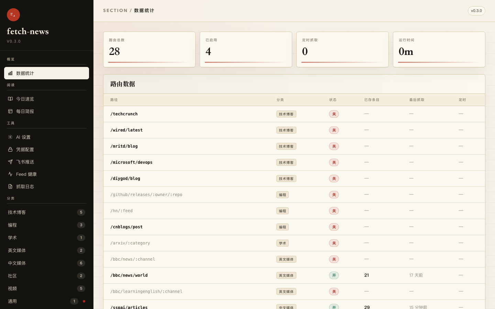

# fetch-news

信息爆炸时代的个人信息过滤器。自托管 RSS 聚合服务，精选高质量信息源，接入本地 Ollama 做翻译和摘要。

每个路由都输出标准 RSS，可直接用任意订阅器消费；内置 Web 阅读器，支持按分类浏览、AI 摘要一键生成、书签收藏、每日简报。




## 信息源

### 内置精选源

下列 51 个精选来源覆盖科技、社会、科学、经济与人文。本轮新增健康医学、心理认知、教育学习、人文历史、艺术影像、城市建筑、数据洞察、硬件创客、游戏开发和游戏文化 10 个分类，共 20 个来源。在 `/index#subscriptions` 的“订阅来源”中选择来源和频率，点击“订阅并抓取”即可开始，无需填写上游 URL、API Key 或 Cookie。新增源默认关闭；只有主动订阅才会设置计划和首次抓取。已有计划、Cron 和其他设置均保留，下表的推荐值不会覆盖它们。

也可以点击订阅页的“添加 RSS 订阅”，在弹窗中填写名称和 RSS / Atom 地址。保存后会显示新的来源卡片，再选择频率并点击“订阅并抓取”。订阅后，卡片会自动显示抓取进度、实际保存结果或等待重试时间；点击“去阅读”进入该来源的待读列表。“暂停订阅”会停止后续自动更新，保留文章和更新计划；已开始的抓取会完成。高级设置用于调整现有频率、Cron 或自定义 RSS 地址。旧配置若只是启用但未设计划，会显示“仅手动更新”，点击“开启自动更新”即可补齐。

| 分类 | 来源与内容 | 路由 | 建议间隔 |
|------|-----------|------|---------|
| AI | [Hugging Face](https://huggingface.co/blog) · 开源模型、工具和实践 | `/huggingface/blog` | 120 分钟 |
| AI | [Google Research](https://research.google/blog/) · 一手研究解读 | `/google/research` | 360 分钟 |
| AI | [OpenAI](https://openai.com/news/) · 研究、产品和工程动态 | `/openai/news` | 180 分钟 |
| GitHub 项目 | [GitHub Open Source](https://github.blog/open-source/) · 开源项目、维护者和社区报道 | `/github/open-source` | 360 分钟 |
| GitHub 项目 | [GitHub Changelog](https://github.blog/changelog/) · 开发平台更新 | `/github/changelog` | 120 分钟 |
| GitHub 项目 | [Ollama Releases](https://github.com/ollama/ollama/releases) · 本地模型工具版本说明 | `/ollama/releases` | 180 分钟 |
| GitHub 项目 | [Transformers Releases](https://github.com/huggingface/transformers/releases) · 模型库版本说明 | `/huggingface/transformers/releases` | 180 分钟 |
| 社会新闻 | [中新网社会](https://www.chinanews.com.cn/rss/index.shtml) · 大陆社会与民生 | `/chinanews/society` | 30 分钟 |
| 社会新闻 | [联合国新闻中文](https://www.ungeneva.org/zh/news-media/rss) · 人道、健康、气候及公共议题 | `/un/news/zh` | 60 分钟 |
| 社会新闻 | [香港电台本地](https://news.rthk.hk/rthk/ch/rss.feed) · 香港社会与公共政策（繁体） | `/rthk/local` | 30 分钟 |
| 社会新闻 | [The Guardian 世界](https://www.theguardian.com/help/feeds) · 国际与社会新闻（英文） | `/guardian/world` | 60 分钟 |
| 科学探索 | [NASA](https://www.nasa.gov/rss-feeds/) · 航天任务与科学动态（英文） | `/nasa/news` | 180 分钟 |
| 科学探索 | [Quanta Magazine](https://www.quantamagazine.org/about/) · 数学与基础科学深度报道（英文） | `/quanta/magazine` | 360 分钟 |
| 科学探索 | [Science News](https://www.sciencenews.org/about-science-news/frequently-asked-questions) · 综合科学新闻（英文摘要） | `/sciencenews/latest` | 180 分钟 |
| 气候环境 | [Carbon Brief](https://www.carbonbrief.org/about) · 气候、能源与政策分析（英文） | `/carbonbrief/news` | 360 分钟 |
| 气候环境 | [NOAA](https://www.noaa.gov/rss-feeds) · 海洋、天气与气候机构动态（英文） | `/noaa/news` | 360 分钟 |
| 软件工程 | [Cloudflare Blog](https://blog.cloudflare.com/) · 网络、性能与工程实践（英文） | `/cloudflare/blog` | 180 分钟 |
| 软件工程 | [Martin Fowler](https://martinfowler.com/) · 软件架构、设计与重构（英文） | `/martinfowler/articles` | 360 分钟 |
| 软件工程 | [Netflix TechBlog](https://netflixtechblog.com/) · 分布式系统与工程实践（英文） | `/netflix/techblog` | 360 分钟 |
| 软件工程 | [InfoQ 中文](https://www.infoq.cn/) · 软件开发与架构资讯 | `/infoq/china` | 120 分钟 |
| 网络安全 | [Google Security](https://blog.google/security/) · 安全研究与防护更新（英文） | `/google/security` | 180 分钟 |
| 网络安全 | [Krebs on Security](https://krebsonsecurity.com/) · 安全事件调查报道（英文） | `/krebs/security` | 180 分钟 |
| 网络安全 | [Schneier on Security](https://www.schneier.com/) · 安全、隐私与政策评论（英文） | `/schneier/security` | 180 分钟 |
| 商业经济 | [欧洲央行博客](https://www.ecb.europa.eu/home/html/rss.en.html) · 欧元区宏观与货币政策（英文） | `/ecb/blog` | 120 分钟 |
| 商业经济 | [美联储 FEDS Notes](https://www.federalreserve.gov/feeds/feeds.htm) · 经济金融研究札记（英文） | `/federalreserve/feds-notes` | 120 分钟 |
| 商业经济 | [中新网财经](https://www.chinanews.com.cn/rss/rss2.html) · 国内经济与产业资讯 | `/chinanews/finance` | 60 分钟 |
| 设计文化 | [Smashing Magazine](https://www.smashingmagazine.com/) · 网页设计、UX 与可访问性（英文） | `/smashing/articles` | 180 分钟 |
| 设计文化 | [Aeon](https://aeon.co/about) · 哲学、心理与人文深度文章（英文） | `/aeon/essays` | 120 分钟 |
| 设计文化 | [中新网文化](https://www.chinanews.com.cn/rss/rss2.html) · 文化、艺术与历史资讯 | `/chinanews/culture` | 120 分钟 |
| 科技精选 | [阮一峰](https://www.ruanyifeng.com/feed.html) · 网络日志与科技爱好者周刊 | `/ruanyifeng/blog` | 1440 分钟 |
| 科技精选 | [Solidot](https://www.solidot.org/) · 科技、科学与开源资讯中文编译 | `/solidot/news` | 120 分钟 |
| 健康医学 | [KFF Health News](https://kffhealthnews.org/rss-feeds/) · 公共健康、医疗制度与健康政策深度报道（英文） | `/kff/health-news` | 360 分钟 |
| 健康医学 | [STAT](https://www.statnews.com/about/) · 医学、生命科学与医疗行业新闻（英文；部分原文需订阅） | `/stat/news` | 180 分钟 |
| 心理认知 | [Psyche](https://psyche.co/about) · 心理、认知与自我理解科普（英文） | `/psyche/magazine` | 360 分钟 |
| 心理认知 | [APS 心理科学研究](https://www.psychologicalscience.org/news/releases) · 心理学研究发布与学术进展（英文） | `/aps/research` | 720 分钟 |
| 教育学习 | [EdSurge](https://www.edsurge.com/about-edsurge) · 教育创新、教学实践与教育科技报道（英文） | `/edsurge/news` | 360 分钟 |
| 教育学习 | [The Hechinger Report](https://hechingerreport.org/about/) · 教育公平、学习成效与学校创新深度报道（英文） | `/hechinger/report` | 360 分钟 |
| 人文历史 | [JSTOR Daily](https://daily.jstor.org/about/) · 以学术研究解读历史、文化与公共议题（英文） | `/jstor/daily` | 360 分钟 |
| 人文历史 | [公共领域评论](https://publicdomainreview.org/about/) · 探索历史艺术、文学与思想中的公共领域珍藏（英文） | `/public-domain-review/latest` | 1440 分钟 |
| 艺术影像 | [Colossal](https://www.thisiscolossal.com/about/) · 当代艺术、手工艺、摄影与视觉文化精选（英文） | `/colossal/latest` | 360 分钟 |
| 艺术影像 | [Aperture](https://aperture.org/about/) · 摄影作品、艺术家访谈与摄影书评论（英文） | `/aperture/articles` | 1440 分钟 |
| 城市建筑 | [Dezeen](https://www.dezeen.com/) · 全球建筑、室内空间与设计项目报道（英文） | `/dezeen/latest` | 180 分钟 |
| 城市建筑 | [ArchDaily](https://www.archdaily.com/content/about) · 全球建筑案例、城市空间与建筑行业观察（英文） | `/archdaily/latest` | 180 分钟 |
| 数据洞察 | [Our World in Data](https://ourworldindata.org/) · 人口、健康与全球发展数据研究（英文） | `/ourworldindata/articles` | 360 分钟 |
| 数据洞察 | [Pew Research Center](https://www.pewresearch.org/about/follow-us/) · 民意调查、人口与社会趋势研究（英文） | `/pewresearch/publications` | 360 分钟 |
| 硬件创客 | [Hackaday](https://hackaday.com/about/) · 硬件改造、电子工程与创客项目（英文） | `/hackaday/posts` | 120 分钟 |
| 硬件创客 | [Raspberry Pi](https://www.raspberrypi.com/news/) · 树莓派项目实践、软硬件与产品动态（英文） | `/raspberrypi/news` | 360 分钟 |
| 游戏开发 | [Godot Engine](https://godotengine.org/blog/) · 游戏引擎开发进展、技术文章与版本发布（英文） | `/godot/news` | 360 分钟 |
| 游戏开发 | [Factorio Friday Facts](https://factorio.com/blog/) · 工厂游戏开发日志、性能优化与设计实践（英文） | `/factorio/blog` | 720 分钟 |
| 游戏文化 | [机核](https://www.gcores.com/media) · 游戏文化、社区创作与活动资讯 | `/gcores/articles` | 120 分钟 |
| 游戏文化 | [游研社](https://www.yystv.cn/rss/) · 游戏报道、行业故事与文化观察 | `/yystv/articles` | 120 分钟 |

Science News 提供可直接订阅的摘要，官网全文可能受阅读额度或订阅限制；ECB 博客的 RSS 仅提供标题、日期和链接，缺少的摘要保持为空。Netflix RSS 自带的正文和作者会直接保留，无需逐篇抓取；Smashing 的 RSS 包含较大的历史正文，建议低频刷新。[Aeon RSS](https://aeon.co/terms-of-use) 用于个人非商业阅读。NASA、NOAA、央行及企业博客反映各机构的研究和观点；独立评论、编译资讯也保留原作者与来源。已有 arXiv 可继续补充论文原文，本表以适合日常阅读的内容为主。

这些来源使用机构官方 RSS 或 GitHub 官方 API，每次刷新只取列表，不逐篇请求全文。新 RSS 路由共用条件请求、持久化退避和 Feed 健康记录；上游允许缓存并支持校验头时可复用 `304` 响应。GitHub 发布源使用 [Releases API](https://docs.github.com/en/rest/releases/releases)，保留标注为预发布的 release，排除草稿及未创建 release 的 tag；只读取默认第一页。[未认证请求限额](https://docs.github.com/en/rest/using-the-rest-api/rate-limits-for-the-rest-api)为每个出口 IP 每小时 60 次，建议避免高频刷新。

2026-10-22 新增的 20 个来源均通过项目实际 Java 客户端与 RSS/Atom 解析器验证。健康与教育类主要覆盖海外研究、公共议题和美国制度；机核和游研社提供中文游戏文化内容。STAT 部分原文属于 STAT+，Aperture 数字档案可能需另行订阅；RSS 摘要可直接阅读。艺术与建筑类的完整图片请前往原文。ArchDaily 使用官网指定的 FeedBurner 托管源；部分媒体也包含活动或赞助内容。

2026-10-21 至 22 日已通过实际 Java 客户端验证上述源。无需付费新闻接口，但 AI 摘要和推送沿用全局设置：订阅后的首次抓取、自动更新或“立即刷新”可能触发已启用的 AI 摘要与飞书投递。官方接口降低了维护成本；可达性仍取决于部署网络及上游服务，不代表长期可用性保证。保留原文链接和署名，按各来源的 RSS 使用条款使用内容。

### 其他来源与通用路由

| 分类 | 路由 | 来源 |
|------|------|------|
| 技术博客 | `/techcrunch` | TechCrunch |
| 技术博客 | `/wired/latest` | WIRED |
| 技术博客 | `/mritd/blog` | mritd |
| 技术博客 | `/microsoft/devops` | Microsoft DevOps Blog |
| 技术博客 | `/diygod/blog` | DIYGod |
| 编程 | `/github/releases/:owner/:repo` | GitHub Releases |
| 编程 | `/hn/:feed` | Hacker News（top / new / best / ask / show / job） |
| 编程 | `/cnblogs/post` | 博客园精华 |
| 学术 | `/arxiv/:category` | arXiv（cs.AI / cs.LG / cs.CV 等） |
| 英文媒体 | `/bbc/news/:channel` | BBC News 全文 |
| 英文媒体 | `/bbc/learningenglish/:channel` | BBC 英语学习 |
| 中文媒体 | `/sspai/articles` | 少数派 |
| 中文媒体 | `/36kr/news` | 36氪 |
| 中文媒体 | `/huanqiu/news` | 环球网 |
| 中文媒体 | `/huanqiu/tech/:section` | 环球网科技 |
| 中文媒体 | `/xinhua/news` | 新华网 |
| 中文媒体 | `/cctv/news/:category` | 央视新闻 |
| 社区 | `/twitter/user/:id` | Twitter/X 用户时间线 |
| 社区 | `/producthunt/daily` | Product Hunt 每日精选 |
| 视频 | `/bilibili/user/video/:uid` | B站 UP主视频 |
| 视频 | `/bilibili/user/dynamic/:uid` | B站 UP主动态 |
| 视频 | `/bilibili/followings/dynamic/:uid` | B站关注动态（全量） |
| 视频 | `/bilibili/followings/video/:uid` | B站关注视频动态 |
| 视频 | `/bilibili/followings/article/:uid` | B站关注专栏 |
| 通用 | `/rss` | 任意 RSS 2.0 / Atom 源 |

## 阅读器

访问 `http://localhost:8080/reader` 进入今日速览，按分类过滤、未读/已读/收藏筛选、全文搜索均在此页完成。

点击「站内阅读」可阅读已保存内容、调整字号、收藏，并在读完后返回原列表。同一浏览器标签页会在返回时一次性恢复筛选和阅读位置；完成的文章若已从列表消失，会定位到下一篇仍可见的文章，并使用服务器最新的已读和收藏状态。读状态和收藏操作保存明确的目标状态，响应丢失后重试不会反向切换；请求超过 15 秒会解除等待，允许重试。收藏夹显示已读状态，点击标题打开原文时也会保存为已读。

**每日简报**（`/reader/briefing`）将当天内容按分类聚合，以双栏简报形式呈现，支持按日期翻页查看历史。同一分类内，较长且相同的标题会折叠为一组，可展开查看各篇原文、来源和独立摘要；文章的已读与收藏状态仍各自保留。标题比较忽略英文大小写、全半角与连续空白，保留数字和标点。每个分类最多展示 15 组，组内报道可全部展开，计数分别显示报道组数与文章数。

## AI 摘要

支持 Ollama、OpenAI Chat Completions 和 Anthropic Messages。在管理后台「AI 设置」中可保存多个平台的 API 地址、密钥和模型，并切换当前平台供摘要、必要时的正文清理和精选日报使用。摘要任务优先使用已保存正文；需要获取原文时，会直接缓存网页中明确且足够长的正文区域，无法识别这类区域时才交给 AI 清理。默认仍为本地 Ollama；第三方兼容选项和迁移方式见 [AI 平台配置](docs/ai-platforms.md)。

站内阅读页可直接生成摘要，显示排队和生成进度，失败后可手动重试。每日简报中的主报道和折叠报道也会自动更新待完成的摘要，失败时可进入文章页重试。刷新页面会恢复已有任务；网络中断时可先「查看状态」，轮询只查询状态，不会重复提交生成任务。摘要生成不影响继续阅读或收藏，已保存摘要在关闭 AI 后仍可查看。订阅只提供短预告时，摘要任务提取的正文会缓存下来，再次打开文章即可阅读。

## 飞书推送

在管理后台「飞书推送」页配置 Webhook，支持定时推送和手动触发，可将当日简报或指定分类的内容推送到飞书群。

## 运行

**Docker（推荐）**

```bash
docker compose up -d
```

访问 `http://localhost:8080`，后台管理在 `http://localhost:8080/index`。

**本地开发**

```bash
./gradlew bootRun   # 需要 JDK 25
```

## TG 与 X 科技资讯

在 `/index#subscriptions` 的「TG 科技」和「X 科技」分类中可选择以下来源，点击「订阅并抓取」开启自动更新。新增来源默认关闭，已有订阅和更新计划不变。

| 平台 | 来源与侧重 | 路由 | 推荐更新频率 |
|---|---|---|---|
| TG | [科技爱好者周刊](https://t.me/s/scitech_fans) · 阮一峰周刊分发，频道说明标注已获授权 | `/telegram/scitech_fans` | 1440 分钟 |
| TG | [Newlearner 自留地](https://t.me/s/NewlearnerChannel) · 科技资讯、效率工具与开发者数字生活 | `/telegram/newlearner` | 120 分钟 |
| TG | [Solidot](https://t.me/s/solidot) · 科技、开源与科学资讯，非官方转发频道 | `/telegram/solidot` | 120 分钟 |
| X | [OpenAI](https://x.com/OpenAI) · 模型、API 与开发工具官方动态 | `/x/openai` | 180 分钟 |
| X | [Anthropic](https://x.com/AnthropicAI) · Claude、研究与开发工具官方动态 | `/x/anthropic` | 180 分钟 |
| X | [Hugging Face](https://x.com/huggingface) · 开放模型、数据集与开源 AI 工具 | `/x/huggingface` | 180 分钟 |
| X | [Andrej Karpathy](https://x.com/karpathy) · AI 技术解读、模型训练与编程实践 | `/x/karpathy` | 360 分钟 |
| X | [Simon Willison](https://x.com/simonw) · LLM 应用、AI 编程与开源实践 | `/x/simonw` | 180 分钟 |
| X | [GitHub](https://x.com/github) · 开源生态、开发工具与平台官方动态 | `/x/github` | 360 分钟 |

TG 通过 `t.me/s/<channel>` 公开预览获取最新一页的文字和链接预览，无需登录或 Bot Token；保留帖子永久链接、频道署名和原始时间，不下载附件或抓取私有频道。只有媒体或需要打开 Telegram 才能读取的帖子会跳过。可在高级设置中为 `/telegram/channel/:channel` 创建其他公开频道的挂载，用户名不含 `@`。Solidot TG 与已有 `/solidot/news` 内容重合，周刊也与 `/ruanyifeng/blog` 重合，可按阅读习惯选择。

2026-10-23 已通过项目实际 Java HTTP 客户端验证三个 TG 频道，共读取 59 条可读帖子，链接唯一、发布时间完整，生成的 RSS 可解析。频道最近发布分别为 10 月 16 日、22 日和 21 日；周刊按周更新。

X 来源复用现有时间线接口，需要先在 `/index#credentials` 保存包含 `auth_token` 和 `ct0` 的登录 Cookie，或设置 `TWITTER_COOKIE` 环境变量；六个来源共用这份凭据。没有凭据时会显示配置提示。X 可能因登录过期、限流或接口变化而抓取失败；此轮未提供登录凭据，完成了离线接口与订阅流程验证，未验证真实 X 时间线抓取。需要无需登录的信息源时，可使用已有 OpenAI、Hugging Face、GitHub 官方博客订阅。

## 凭据配置

在 `docker-compose.yml` 中按需填写：

- `BILIBILI_COOKIE` — B站公开路由（无需登录，填 buvid3/buvid4 即可）
- `BILIBILI_COOKIE_<uid>` — 关注动态路由，需已登录账号的完整 Cookie
- `TWITTER_COOKIE` — Twitter 路由，需 `auth_token` + `ct0`
- `OLLAMA_HOST` — Docker 内访问宿主机 Ollama 时填 `http://host.docker.internal:11434`

## 技术栈

Spring Boot · Thymeleaf + HTMX + Alpine.js · JSoup · SQLite · Caffeine · Ollama · Java 25

### 精选日报

新增 Profile 评分、事件去重、配额与持久化精选日报，入口 `/reader/radar`。默认关闭，启用与恢复方式见 [使用文档](docs/radar.md)。
