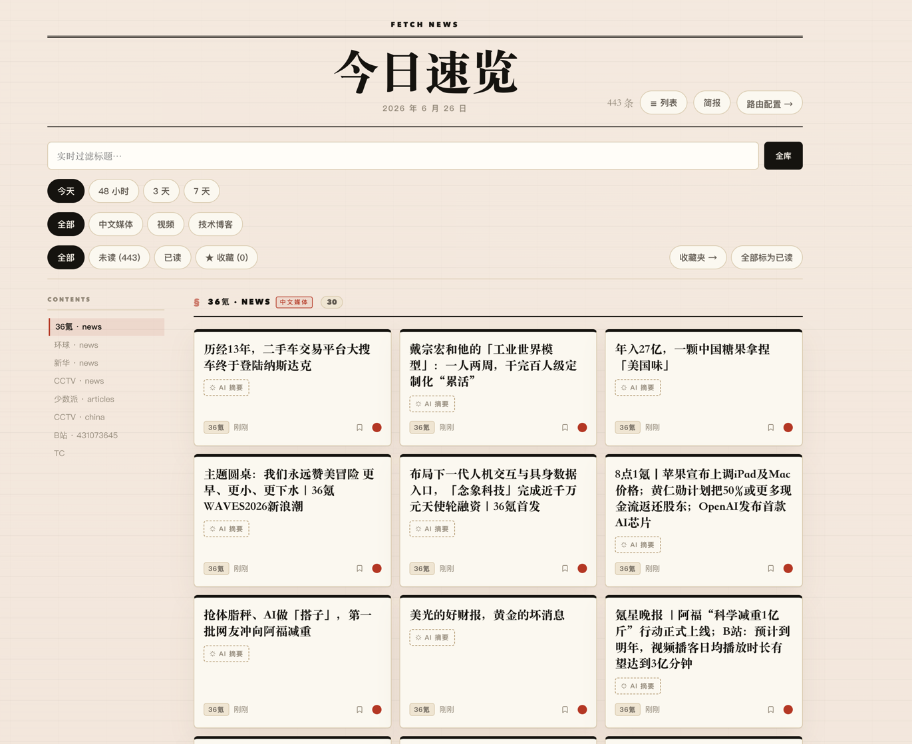
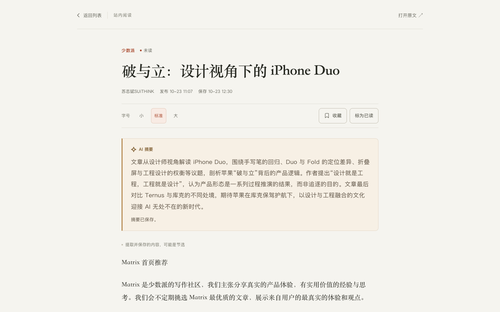
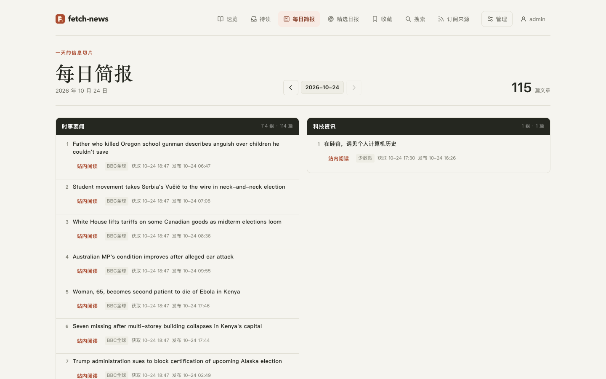
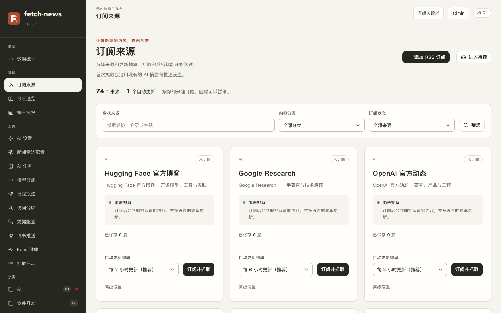

# fetch-news

自托管的个人信息过滤器：订阅精选来源，统一输出标准 RSS，再用内置阅读器和 AI 帮你挑出值得读的内容。



| 站内阅读 · AI 摘要 | 每日简报 | 订阅来源 |
|---|---|---|
|  |  |  |

## 功能

**订阅**
- 内置 74 个可直接订阅的来源，分属 13 个主题，从时事、AI、软件开发到设计、游戏。选择更新频率后点「订阅并抓取」即可，不需要填地址或密钥。
- 也可以添加任意 RSS / Atom 地址，或通过参数化路由订阅 GitHub 仓库发布、arXiv 分类、B 站 UP 主、Telegram 公开频道等。
- 每个来源都输出标准 RSS 2.0（`?format=json` 输出 JSON），可以接入任何 RSS 阅读器。

**阅读**
- **今日速览**：按来源分组的卡片，带封面、摘录和已读/收藏状态。
- **每日简报**：按主题汇总当天内容，相同报道自动折叠，可翻看历史日期。
- **站内阅读**：阅读已保存的正文，可调字号、收藏，返回时恢复原来的列表位置。
- **收藏**和**全文搜索**（标题、正文与摘要）。
- 键盘操作：`j` / `k` 上下移动，`o` 打开，`b` 收藏，`r` 标为已读。

**AI**（可选，默认关闭）
- **摘要**：在文章上点「AI 摘要」即可生成，你点的任务优先于后台任务处理。也可以为个别来源开启自动摘要，每次抓取最多为 5 篇新文章生成。
- **必知 / 精选**：AI 每个主题每天最多挑 3 篇「必知」（重大、影响面广）和 3 篇「精选」（有深度、值得细读），并附上理由。点「准 / 不准」反馈后，之后的挑选会参考你的判断。
- 支持 Ollama、OpenAI 兼容接口和 Anthropic 接口，可以保存多个平台并随时切换。详见 [AI 平台配置](docs/ai-platforms.md)。

**推送与日报**
- **飞书推送**：新文章按来源即时推送，或按主题定时推送摘要。
- **精选日报**：启用 AI 后，每天 8 点自动为前一天的文章打分、合并同一事件的报道，生成一份带中文解读的日报，也可以在 `/reader/radar` 随时手动生成。详见 [精选日报](docs/radar.md)。

**多账户**：令牌登录，每个账户的收藏、已读和反馈互相独立，适合通过内网穿透分享给家人朋友。

## 快速开始

### Docker

需要 JDK 25 先构建 jar，再打包镜像：

```bash
./gradlew bootJar
cp build/libs/fetch-news-*.jar app.jar
docker compose up -d --build
```

访问 `http://localhost:8080`。数据库和所有配置都保存在宿主机的 `./data` 目录，重建容器不会丢失。

首次启动时，管理员令牌只会在日志里打印一次：

```bash
docker compose logs fetch-news | grep -A1 "admin token"
```

打开 `/login` 输入令牌即可登录，浏览器会记住 180 天。之后在 `/index#subscriptions` 选择来源订阅即可开始阅读。

### 本地运行

```bash
./gradlew bootRun   # 需要 JDK 25
```

访问 `http://localhost:14001`。数据库和配置文件保存在项目根目录，均已被 `.gitignore` 忽略。

## 账户与公网访问

服务默认开启令牌认证，网页、RSS 和 API 都需要令牌。

**固定或重置管理员令牌**（忘记令牌时也用这个办法），令牌至少 16 个字符：

```bash
FETCH_NEWS_ADMIN_TOKEN="$(openssl rand -base64 32 | tr '+/' '-_' | tr -d '=')" ./gradlew bootRun
```

Docker 部署时在 `docker-compose.yml` 中设置同名环境变量。

**给别人开账户**：在后台「访问令牌」页填写名称、选择权限，令牌只显示一次。

| 权限 | 可以做什么 |
|---|---|
| 成员 | 阅读、收藏、标记已读、AI 摘要、订阅 RSS |
| 管理员 | 以上全部，外加来源、AI、推送和账户管理 |

**在 RSS 阅读器中订阅**：在右上角「账户」页复制带 `?key=fk_…` 的订阅地址，或「下载 OPML」一次导入全部已启用来源。`key` 只能读取 RSS，不能登录网页；泄露后在账户页重置，旧地址立即失效。支持 HTTP 认证的阅读器也可以不带 `key`，用户名随意，密码填登录令牌。

**撤销**：后台可以重置任意账户的令牌或订阅密钥，也可以停用或删除账户（删除时一并清除其收藏和已读记录），均立即生效。

**通过 frp 暴露到公网**：务必使用 HTTPS，否则令牌会以明文经过公网。frpc 配置示例（`localPort` 按实际端口修改）：

```toml
serverAddr = "your-frps-host"
serverPort = 7000

[[proxies]]
name = "fetch-news"
type = "https"
customDomains = ["news.example.com"]

[proxies.plugin]
type = "https2http"
localAddr = "127.0.0.1:8080"
crtPath = "./news.example.com.crt"
keyPath = "./news.example.com.key"
requestHeaders.set.X-Forwarded-Proto = "https"
```

`X-Forwarded-Proto` 让登录 Cookie 带上 `Secure` 标记。请保留原始 `Host` 头（不要设置 `hostHeaderRewrite`），或同时传入 `X-Forwarded-Host`，否则页面上的操作会被同源校验拒绝。

只在可信内网使用时，可以设置 `FETCH_NEWS_AUTH_ENABLED=false` 关闭认证。

## 信息源

完整目录、介绍和推荐更新频率都在后台「订阅来源」页。下面按主题列出代表来源：

| 主题 | 代表来源 |
|---|---|
| 时事要闻 | BBC News、The Guardian、联合国新闻中文、香港电台、中新网、新华网、央视新闻 |
| AI | OpenAI、Google Research、Hugging Face、Ollama 与 Transformers 版本发布 |
| 科技资讯 | 阮一峰、Solidot、少数派、36氪、Hacker News、TechCrunch、WIRED、Hackaday |
| 软件开发 | GitHub Changelog、Cloudflare、Martin Fowler、Netflix TechBlog、InfoQ 中文 |
| 网络安全 | Google Security、Krebs on Security、Schneier on Security |
| 财经商业 | 欧洲央行博客、美联储 FEDS Notes、中新网财经 |
| 科学 | NASA、Quanta Magazine、Science News、Carbon Brief、NOAA、arXiv |
| 健康医学 | KFF Health News、STAT |
| 人文社会 | Aeon、Psyche、JSTOR Daily、Our World in Data、Pew Research |
| 设计艺术 | Smashing Magazine、Colossal、Aperture、Dezeen、ArchDaily |
| 游戏 | Godot、Factorio Friday Facts、机核、游研社 |
| 关注动态 | B 站 UP 主与关注动态、X 用户时间线、Telegram 公开频道 |

可以在路由设置里为来源换一个主题。没有现成路由的网站，用通用路由 `/rss` 加上 `feedUrl` 即可挂载任意 RSS / Atom 源。

**需要凭据的来源**：在后台「凭据配置」页保存，或在 `docker-compose.yml` 中设置环境变量。

| 来源 | 需要的凭据 |
|---|---|
| B 站公开路由（UP 主视频、动态） | `BILIBILI_COOKIE`，只需 `buvid3` 和 `buvid4`，不用登录 |
| B 站关注动态 | `BILIBILI_COOKIE_<你的 UID>`，已登录账号的 Cookie |
| X（Twitter） | `TWITTER_COOKIE`，需包含 `auth_token` 和 `ct0` |

X 和 B 站的接口可能因登录过期、限流或风控而失效。Telegram 频道读取公开网页预览，不需要登录或 Bot Token。

**来源说明**：内置来源优先使用官方 RSS 或 API，每次只读取列表第一页。请保留原文链接和署名，并遵守各来源的使用条款；部分来源（如 STAT、Aperture）的原文需要另外订阅。

## 配置

| 环境变量 | 作用 |
|---|---|
| `FETCH_NEWS_ADMIN_TOKEN` | 固定或重置管理员令牌 |
| `FETCH_NEWS_AUTH_ENABLED` | 设为 `false` 关闭认证（仅限可信内网） |
| `OLLAMA_HOST` | 覆盖已保存的 Ollama 地址；Docker 内访问宿主机用 `http://host.docker.internal:11434` |
| `BILIBILI_COOKIE`、`TWITTER_COOKIE` | 见上方「需要凭据的来源」 |
| `JAVA_OPTS` | JVM 参数，默认 `-Xms128m -Xmx512m` |
| `TZ` | 时区，影响显示时间、「今日」统计和定时任务；镜像默认 `Asia/Shanghai` |

AI 平台、飞书推送、来源设置都在后台 `/index` 中修改。所有可用的系统属性见 [CONTEXT.md](CONTEXT.md#system-properties)。

## 开发

技术栈：Java 25 · Spring Boot 4 · SQLite · Thymeleaf + HTMX + Alpine.js · JSoup。

```bash
./gradlew test   # 每个测试任务使用独立的数据库和配置，不会碰你的本地数据
```

- [AGENTS.md](AGENTS.md)：包结构、新增路由的步骤和代码约定。
- [CONTEXT.md](CONTEXT.md)：领域术语和数据流。
- [docs/adr/](docs/adr/)：架构决策记录。
